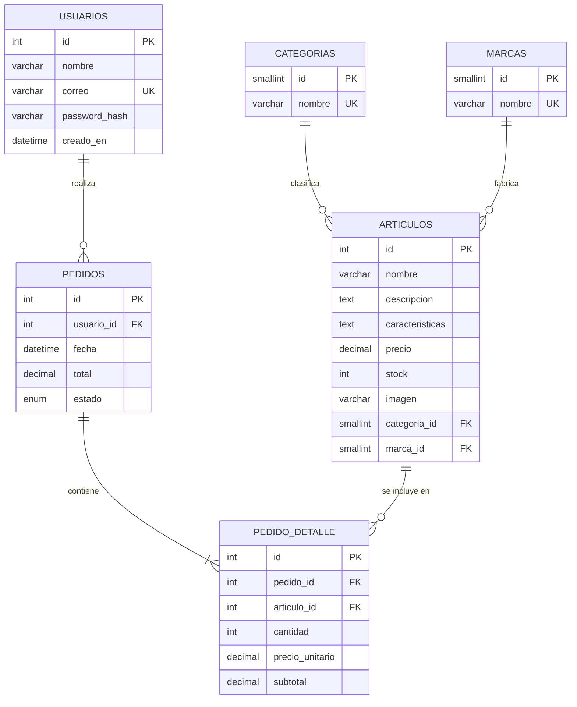

# Modelo entidad-relación

Tarea **T08** · Rol `[DESARROLLO]` · Script: [`database/schema.sql`](../../database/schema.sql)

## Trazabilidad con los requisitos

| Requisito | Tablas |
|---|---|
| R01, R02 Registro e inicio de sesión | `usuarios` |
| R03 Búsqueda básica | `articulos.nombre` (índice) |
| R04 Búsqueda avanzada | `articulos` + `categorias`, `marcas`, `precio`, `stock` |
| R05, R06 Catálogo y detalle | `articulos` (imagen, descripción, características, stock) |
| R07 Compra por artículo | `articulos.stock` (validación de cantidad) |
| R08 Carrito | Sesión PHP (`$_SESSION['carrito']`), sin tabla |
| R09 Registro del pedido | `pedidos`, `pedido_detalle` |

## Decisiones de diseño

- El carrito vive en la sesión: no se necesita persistir carritos abandonados (fuera del alcance).
- `pedido_detalle` guarda `precio_unitario` para que un cambio de precio posterior no altere pedidos ya confirmados.
- `CHECK` en precio y cantidad, y `UNIQUE` en el correo, aplican desde la base de datos los criterios de aceptación de R01 y R07.
